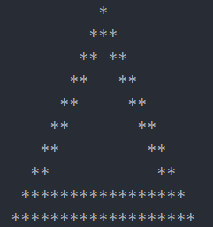
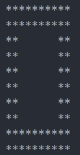

# Can you print this ?

**Time Limit: 1 Sec**  
**Memory Limit: 264 MB**

You are given an integer n. Now print the following pattern.

## Input

First line contains n

n <= 19

## Output

Print the following pattern

## Example

Sample Input 1

```
10
```

Sample Output 1

The original file gives the sample output as two images:



